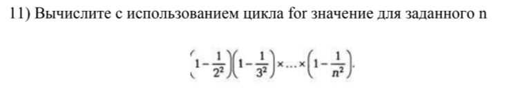
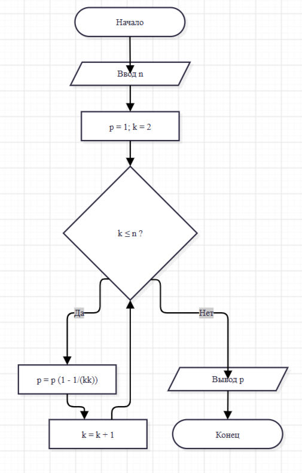

## Домашнее задание к лабораторной 6

### Вариант 11

#define _CRT_SECURE_NO_WARNINGS

#include <stdio.h>

#include <locale.h>

int main()
{
    setlocale(LC_ALL, "Russian");

    int n;
    double p = 1;   // произведение

    printf("Введите n (n >= 2): ");
    scanf("%d", &n);

    for (int k = 2; k <= n; k++)
        p = p * (1 - 1.0 / (k * k));

    printf("Результат: %f\n", p);

    return 0;
}

### Вывод
#### Я освоила цикл `for` с его тремя частями: начальное значение, условие и изменение счётчика. С его помощью я посчитала сумму чисел от m до n, вывела степени двойки и составила таблицу значений функции с шагом, который вводит пользователь. Я поняла, что переменную для накопления результата нужно объявлять до цикла, иначе она не будет видна после него. Цикл `for` удобен, когда число повторений известно заранее.